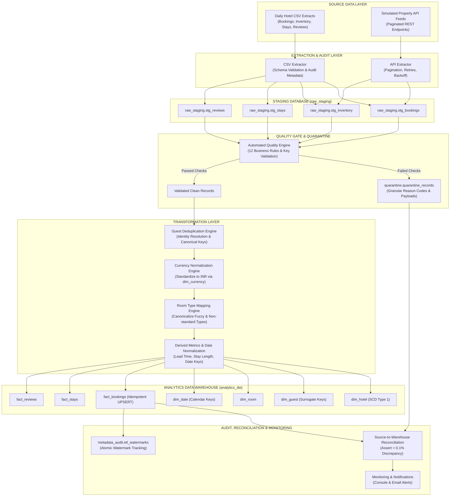

# System Architecture – Hotel Batch Data Pipeline

## 1. High-Level Architecture Overview

The Hotel Batch Data Pipeline implements a multi-tier, decoupled, and idempotent batch processing architecture designed for high reliability, auditability, and analytical query performance.

## 2. Component Breakdown

### 2.1 Extraction Layer
- **CSV Extractor (`src/extraction/csv_extractor.py`)**: Reads structured CSV files from source directories, performs structural column verification, and appends pipeline audit metadata (`source_file`, `source_system`, `extracted_at`).
- **REST API Extractor (`src/extraction/api_extractor.py`)**: Interacts with the simulated FastAPI service (`api/main.py`), utilizing cursor/page-based pagination, exponential retry backoff, and automatic fallback.

### 2.2 Staging Layer
- Schema: `raw_staging`
- Staging tables store ingested records as raw strings with audit metadata (`batch_id`, `staged_at`, `source_system`), ensuring raw data auditability and isolation from the core warehouse.

### 2.3 Quality Gate & Quarantine
- Evaluates 12 deterministic data quality assertions.
- Non-compliant rows are redirected into `quarantine.quarantine_records` alongside original payloads and explicit failure reason codes.

### 2.4 Transformation Layer
- **Guest Deduplication**: Matches guest profiles across bookings using email, phone, and name heuristics without merging distinct individuals.
- **Currency Standardization**: Converts non-INR transactions (e.g. USD) into INR using exchange rates from `dim_currency`.
- **Room Standardization**: Normalizes disparate property descriptions into canonical room categories.
- **Date Normalization**: Standardizes dates and derives analytics fields (`lead_time_days`, `length_of_stay_days`, `total_amount_inr`).

### 2.5 Star Schema Warehouse
- Schema: `analytics_dw`
- Star schema with surrogate keys and dimensional integrity.
- Incremental loading via SQL `ON CONFLICT (...) DO UPDATE` ensuring idempotency.
