# Data Model & Star Schema – Hotel Batch Data Pipeline

## 1. Dimensional Model Overview

The analytics data warehouse (`analytics_dw`) utilizes a dimensional Kimball-style **Star Schema** centered around hotel bookings, physical guest stays, and customer reviews.

```mermaid
erDiagram
    dim_hotel ||--o{ fact_bookings : "booked at"
    dim_guest ||--o{ fact_bookings : "booked by"
    dim_room ||--o{ fact_bookings : "assigned"
    dim_date ||--o{ fact_bookings : "booking date"
    dim_date ||--o{ fact_bookings : "check-in date"
    dim_date ||--o{ fact_bookings : "check-out date"

    dim_hotel ||--o{ fact_stays : "stayed at"
    dim_guest ||--o{ fact_stays : "stayed by"
    dim_room ||--o{ fact_stays : "room occupied"
    dim_date ||--o{ fact_stays : "actual check-in"
    dim_date ||--o{ fact_stays : "actual check-out"

    dim_hotel ||--o{ fact_reviews : "reviewed property"
    dim_guest ||--o{ fact_reviews : "author"
    dim_date ||--o{ fact_reviews : "review date"

    dim_hotel {
        int hotel_key PK
        string hotel_id UK
        string hotel_name
        string location
        string rating_category
        int total_rooms
        boolean is_active
    }

    dim_guest {
        int guest_key PK
        string guest_id UK
        string first_name
        string last_name
        string full_name
        string email
        string phone
        string city
        string state
        string country
    }

    dim_room {
        int room_key PK
        string room_id UK
        string hotel_id
        string canonical_room_type
        int standard_capacity
        numeric base_rate_inr
    }

    dim_date {
        int date_key PK
        date full_date UK
        int day_of_week
        string day_name
        int month_num
        string month_name
        int quarter
        int year_num
        boolean is_weekend
    }

    fact_bookings {
        int booking_key PK
        string booking_id
        string booking_line_id UK
        int hotel_key FK
        int guest_key FK
        int room_key FK
        int booking_date_key FK
        int check_in_date_key FK
        int check_out_date_key FK
        string booking_status
        numeric room_rate_inr
        numeric total_amount_inr
        int number_of_guests
        int lead_time_days
        int length_of_stay_days
        timestamp source_updated_at
        string dw_batch_id
    }

    fact_stays {
        int stay_key PK
        string stay_id UK
        string booking_id
        int hotel_key FK
        int guest_key FK
        int room_key FK
        int check_in_date_key FK
        int check_out_date_key FK
        string stay_status
        timestamp actual_check_in
        timestamp actual_check_out
        numeric actual_duration_hours
        string dw_batch_id
    }

    fact_reviews {
        int review_key PK
        string review_id UK
        string booking_id
        int hotel_key FK
        int guest_key FK
        int review_date_key FK
        int rating
        string review_text
        string sentiment_category
        string dw_batch_id
    }
```

## 2. Table Specifications & Granularity

### 2.1 Fact Tables

#### `analytics_dw.fact_bookings`
- **Grain**: One row per booking line item (`booking_line_id`).
- **Primary Business Key**: `booking_line_id` (Unique).
- **Surrogate Foreign Keys**: `hotel_key`, `guest_key`, `room_key`, `booking_date_key`, `check_in_date_key`, `check_out_date_key`.
- **Measures**:
  - `room_rate_inr`: Standardized rate per night in INR (`NUMERIC(10,2)`).
  - `total_amount_inr`: Calculated total transaction value (`NUMERIC(12,2)`).
  - `number_of_guests`: Occupancy count.
  - `lead_time_days`: Interval between reservation and check-in date.
  - `length_of_stay_days`: Duration of stay in nights.

#### `analytics_dw.fact_stays`
- **Grain**: One row per guest physical stay event (`stay_id`).
- **Measures**:
  - `actual_duration_hours`: Exact length of stay from actual check-in to check-out.

#### `analytics_dw.fact_reviews`
- **Grain**: One row per customer feedback submission (`review_id`).
- **Measures & Attributes**:
  - `rating`: Integer score from 1 to 5.
  - `sentiment_category`: Derived classification (`VERY_POSITIVE`, `POSITIVE`, `NEUTRAL`, `NEGATIVE`, `VERY_NEGATIVE`).

### 2.2 Dimension Tables

- `dim_hotel`: SCD Type 1 dimension tracking properties across Guwahati.
- `dim_guest`: Unified guest profile with canonical deduplication mapping.
- `dim_room`: Physical room definitions and standard capacities.
- `dim_date`: Complete calendar dimension with holiday/weekend flags.
- `dim_currency`: Reference exchange rates to INR.
